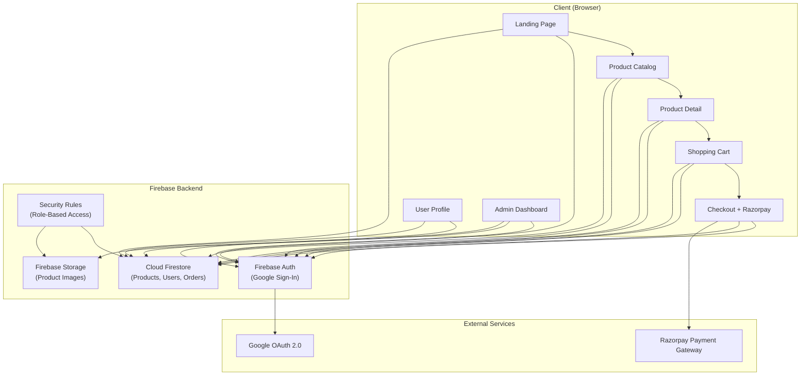
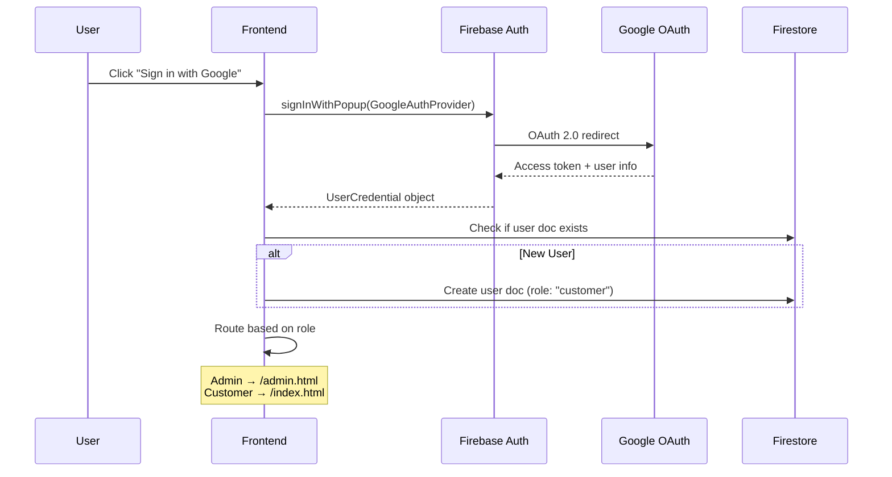
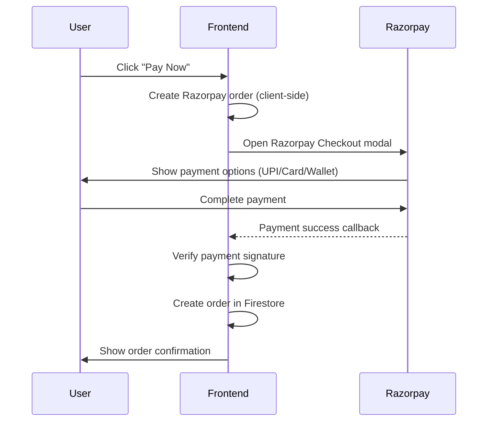

# 🛢️ TamilNadu Cooking Oils — E-Commerce Platform Architecture

## 1. Project Overview

A premium e-commerce platform for selling cooking oils in Tamil Nadu, featuring:
- Stunning visual design with advanced animations & motion graphics
- Google authentication for users
- Admin dashboard for the shopkeeper to manage products
- Razorpay payment gateway (India-native, supports UPI/Cards/Wallets)
- Real-time multi-user support via Firebase
- Proper user data handling with security rules

---

## 2. Technology Stack

| Layer | Technology | Rationale |
|---|---|---|
| **Frontend** | HTML5, CSS3, Vanilla JS | Full control, no framework overhead |
| **Animations** | GSAP (GreenSock) + CSS | Industry-standard motion library |
| **Backend (BaaS)** | Firebase | Serverless, scales automatically, handles concurrency |
| **Authentication** | Firebase Auth (Google Sign-In) | Secure, easy Google OAuth integration |
| **Database** | Cloud Firestore | Real-time sync, handles multiple concurrent users |
| **File Storage** | Firebase Storage | Product images, user avatars |
| **Payments** | Razorpay | India-first gateway — UPI, Cards, Wallets, Net Banking |
| **Hosting** | Firebase Hosting | Free SSL, CDN, fast deploys |
| **Fonts** | Google Fonts (Outfit + Tamil fonts) | Modern typography with regional support |

> [!NOTE]
> Firebase's real-time listeners ensure that when the shopkeeper updates a product, all browsing users see changes instantly — no page refresh needed.

---

## 3. System Architecture



---

## 4. Page Architecture (8 Pages)

| # | Page | Route | Description |
|---|---|---|---|
| 1 | **Landing / Home** | `index.html` | Hero with parallax oil pour animation, featured products, testimonials, about section |
| 2 | **Product Catalog** | `catalog.html` | Filterable grid — by oil type, size, price. Search bar, sort options |
| 3 | **Product Detail** | `product.html?id=xxx` | Full product info, nutritional details, reviews, quantity selector, add-to-cart |
| 4 | **Shopping Cart** | `cart.html` | Cart items, quantity management, price summary, proceed to checkout |
| 5 | **Checkout** | `checkout.html` | Delivery address form, order summary, Razorpay payment button |
| 6 | **User Profile** | `profile.html` | Order history, saved addresses, account settings |
| 7 | **Admin Dashboard** | `admin.html` | Product CRUD, order management, revenue analytics, image upload |
| 8 | **Auth Page** | `auth.html` | Google Sign-In, role routing (admin → dashboard, user → home) |

---

## 5. Database Schema (Firestore Collections)

### `users` Collection
```json
{
  "uid": "firebase-auth-uid",
  "displayName": "Hari Prasath",
  "email": "hari@example.com",
  "photoURL": "https://...",
  "phone": "+91 98xxx xxxxx",
  "role": "customer",           // "customer" | "admin"
  "addresses": [
    {
      "label": "Home",
      "line1": "123 Anna Nagar",
      "line2": "Near Koyambedu",
      "city": "Chennai",
      "state": "Tamil Nadu",
      "pincode": "600040"
    }
  ],
  "createdAt": "Timestamp",
  "updatedAt": "Timestamp"
}
```

### `products` Collection
```json
{
  "id": "auto-generated",
  "name": "Cold Pressed Sesame Oil",
  "nameTamil": "செக்கு நல்லெண்ணெய்",
  "description": "Pure stone-ground sesame oil...",
  "category": "sesame",          // sesame | coconut | groundnut | gingelly | mustard | sunflower
  "price": 450,
  "discountPrice": 399,
  "unit": "1L",
  "sizes": ["500ml", "1L", "2L", "5L"],
  "imageURLs": ["https://..."],
  "stock": 150,
  "isActive": true,
  "nutritionInfo": {
    "calories": "884 kcal/100ml",
    "fat": "100g",
    "saturatedFat": "14g"
  },
  "tags": ["organic", "cold-pressed", "traditional"],
  "rating": 4.5,
  "reviewCount": 23,
  "createdAt": "Timestamp",
  "updatedAt": "Timestamp"
}
```

### `orders` Collection
```json
{
  "id": "auto-generated",
  "userId": "user-uid",
  "userEmail": "hari@example.com",
  "items": [
    {
      "productId": "prod-id",
      "name": "Cold Pressed Sesame Oil",
      "price": 399,
      "quantity": 2,
      "size": "1L",
      "imageURL": "https://..."
    }
  ],
  "subtotal": 798,
  "deliveryCharge": 40,
  "total": 838,
  "deliveryAddress": { ... },
  "status": "placed",           // placed | confirmed | shipped | delivered | cancelled
  "paymentId": "razorpay-payment-id",
  "paymentStatus": "captured",  // created | captured | failed
  "createdAt": "Timestamp",
  "updatedAt": "Timestamp"
}
```

### `reviews` Collection
```json
{
  "id": "auto-generated",
  "productId": "prod-id",
  "userId": "user-uid",
  "userName": "Hari",
  "rating": 5,
  "comment": "Excellent quality oil!",
  "createdAt": "Timestamp"
}
```

---

## 6. Authentication & Security Flow



### Firestore Security Rules (Key Policies)
- **Products**: Anyone can read. Only `role === "admin"` can write.
- **Users**: Each user can read/write only their own document.
- **Orders**: Users can read their own orders. Admins can read all.
- **Reviews**: Authenticated users can create. Only the author can edit/delete.

---

## 7. Payment Flow (Razorpay)



> [!IMPORTANT]
> For production, payment verification should happen server-side using Firebase Cloud Functions. For this MVP, we'll implement client-side verification with Razorpay's test mode.

---

## 8. Visual Design System

### Color Palette
| Token | Hex | Usage |
|---|---|---|
| **Gold Primary** | `#D4A843` | CTAs, highlights, premium feel |
| **Deep Olive** | `#2D3A1E` | Headers, primary text |
| **Warm Cream** | `#FFF8E7` | Backgrounds |
| **Rich Amber** | `#C67C3B` | Accents, hover states |
| **Earth Brown** | `#5C3D2E` | Secondary text, borders |
| **Leaf Green** | `#4A7C3F` | Success states, organic badges |
| **Dark Surface** | `#1A1A2E` | Dark mode background |
| **Glass White** | `rgba(255,255,255,0.08)` | Glassmorphism panels |

### Animation Plan (GSAP)
| Element | Animation | Trigger |
|---|---|---|
| Hero Section | Oil drop pour with liquid physics | Page load |
| Product Cards | Staggered reveal with scale + fade | Scroll into view |
| Page Transitions | Smooth slide + opacity | Navigation |
| Cart Badge | Bounce on item add | User action |
| Price Counter | Number count-up animation | Scroll into view |
| Parallax Layers | Multi-speed background scrolling | Scroll |
| Hover Effects | 3D tilt + glow on product cards | Mouse hover |
| Loading States | Shimmer skeleton screens | Data fetch |
| Floating Elements | Gentle floating oil drops | Continuous |

### Typography
- **Headings**: Outfit (Bold/SemiBold) — modern, premium feel
- **Body**: Inter — excellent readability
- **Tamil Text**: Noto Sans Tamil — proper Tamil script support

---

## 9. File Structure

```
Web1/
├── index.html              # Landing page
├── catalog.html            # Product catalog
├── product.html            # Product detail
├── cart.html               # Shopping cart
├── checkout.html           # Checkout + payment
├── profile.html            # User profile
├── admin.html              # Admin dashboard
├── auth.html               # Authentication page
│
├── css/
│   ├── global.css          # Design tokens, resets, typography
│   ├── components.css      # Reusable component styles
│   ├── animations.css      # All animation keyframes
│   ├── home.css            # Landing page styles
│   ├── catalog.css         # Catalog styles
│   ├── product.css         # Product detail styles
│   ├── cart.css            # Cart styles
│   ├── checkout.css        # Checkout styles
│   ├── profile.css         # Profile styles
│   ├── admin.css           # Admin dashboard styles
│   └── auth.css            # Auth page styles
│
├── js/
│   ├── firebase-config.js  # Firebase initialization
│   ├── auth.js             # Authentication logic
│   ├── firestore.js        # Database CRUD operations
│   ├── storage.js          # Image upload/retrieval
│   ├── cart.js             # Cart management
│   ├── payment.js          # Razorpay integration
│   ├── animations.js       # GSAP animation orchestration
│   ├── router.js           # Client-side navigation helpers
│   ├── admin.js            # Admin dashboard logic
│   ├── home.js             # Landing page logic
│   ├── catalog.js          # Catalog page logic
│   ├── product.js          # Product detail logic
│   ├── profile.js          # Profile page logic
│   └── utils.js            # Helpers (formatPrice, debounce, etc.)
│
├── assets/
│   ├── images/             # Static images, icons, logo
│   └── fonts/              # Local font files if needed
│
└── firebase.json           # Firebase hosting config
```

---

## 10. Implementation Phases

### Phase 1: Foundation (Core Setup)
- [ ] Set up project structure & design system (`global.css`, `components.css`)
- [ ] Configure Firebase (Auth, Firestore, Storage)
- [ ] Implement Google Sign-In auth flow
- [ ] Build responsive navigation & footer components

### Phase 2: Storefront (Customer-Facing)
- [ ] Build Landing Page with GSAP hero animations & parallax
- [ ] Build Product Catalog with filters, search, and animated cards
- [ ] Build Product Detail page with reviews
- [ ] Build Shopping Cart with real-time updates

### Phase 3: Commerce (Transactions)
- [ ] Integrate Razorpay payment gateway
- [ ] Build Checkout flow with address management
- [ ] Implement order creation & status tracking
- [ ] Build User Profile with order history

### Phase 4: Admin (Shopkeeper Panel)
- [ ] Build Admin Dashboard with analytics overview
- [ ] Implement Product CRUD (Create, Read, Update, Delete)
- [ ] Implement Order management & status updates
- [ ] Image upload to Firebase Storage

### Phase 5: Polish & Deploy
- [ ] Add all micro-animations & transitions
- [ ] Responsive testing (mobile, tablet, desktop)
- [ ] SEO optimization (meta tags, structured data)
- [ ] Deploy to Firebase Hosting

---

## 11. Key Design Decisions

> [!TIP]
> **Why Firebase over a traditional backend?**
> - Zero server management — scales automatically for multiple concurrent users
> - Real-time listeners — product updates by admin reflect instantly for shoppers
> - Built-in Google Auth — no custom OAuth implementation needed
> - Free tier is generous enough for an MVP

> [!TIP]
> **Why Razorpay over Stripe?**
> - Native to India, built for Indian merchants
> - Supports UPI (most popular payment method in Tamil Nadu)
> - Lower transaction fees for domestic payments
> - Easy integration with client-side SDK

> [!WARNING]
> **Before going live, you'll need:**
> - A Razorpay merchant account (KYC verification)
> - A Firebase project on Blaze (pay-as-you-go) plan for production
> - Firebase Cloud Functions for server-side payment verification
> - A custom domain name

---

## 12. Questions Before We Build

Before I start implementation, please confirm:

1. **Business Name**: What's your shop/brand name? (I'll use it for the logo & branding)
2. **Product Categories**: Are these your oil types? — Sesame, Coconut, Groundnut, Gingelly, Mustard, Sunflower. Any others?
3. **Firebase Project**: Do you already have a Firebase project, or should I guide you through creating one?
4. **Razorpay Account**: Do you have a Razorpay account, or should we use test mode for now?
5. **Language**: Should the site be bilingual (English + Tamil)?
6. **Delivery**: Is delivery handled manually or do you want delivery zone/pincode restrictions?
